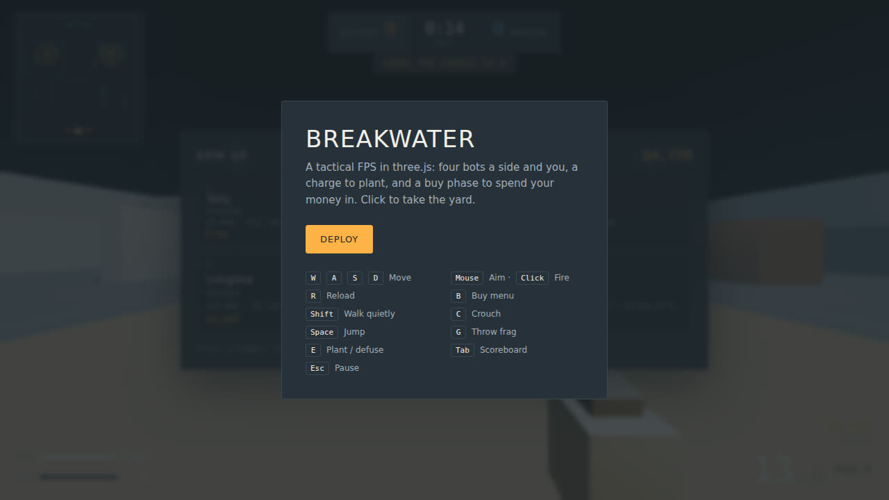

# BREAKWATER — a three.js tactical FPS

[](https://make.fun/bounty/threejs-fps-01?utm_source=github&utm_medium=readme&utm_campaign=threejs-fps-01)
[](https://make.fun/bounty/threejs-fps-01/leaderboard?utm_source=github&utm_medium=readme&utm_campaign=threejs-fps-01)
[](https://make.fun/bounty/threejs-fps-01?utm_source=github&utm_medium=readme&utm_campaign=threejs-fps-01)

A complete, round-based tactical FPS that runs in the browser from static files, with no build
step and no network. Four bots a side and you on the Dockers, on a container terminal at dusk: two
teams, a buy phase with a real economy, a charge to plant and defuse, and bots that hold angles,
take cover and punish a spray. Written as ES modules on top of three.js 0.187, with the map, the art direction
and every sound generated by the code in this repository.

## What is in the box

| Piece | Where | What it does |
|---|---|---|
| The map | `game/src/world.js` | BREAKWATER: warehouse site A, container-yard site B, a three-lane layout, colliders, lamp lighting and a navigation lattice |
| The body | `game/src/player.js` | One controller for the player and every bot: accelerated movement, crouch, jump, swept AABB collision |
| The arsenal | `game/src/weapons.js` | Four weapons with their own damage, cone, recoil climb and armour penetration, and one frag |
| The gun in your hands | `game/src/viewmodel.js` | One silhouette per weapon, built from a parts table at boot: a service pistol, a compact SMG, a rifle and the scoped long rifle, each with its own barrel mouth, kick and reload dip |
| The charge | `game/src/bomb.js` | The case on the ground where it was planted, with a lamp that blinks faster as the fuse runs down |
| The frag | `game/src/grenades.js` | Thrown from the eye, a two-and-a-half second fuse, a bounce off the floor and the walls, and a blast that falls off with distance and stops at the first wall |
| The opposition | `game/src/bots.js` | Straight-line steering with A* over the lattice when a wall is in the way, a field of view with line of sight, reaction delay, burst discipline, site takes and retakes |
| The round | `game/src/match.js` | Freeze time, live round, money and loss bonuses, the charge, first to thirteen with a side swap at twelve |
| The interface | `game/src/hud.js`, `game/index.html` | Buy menu, killfeed, scoreboard, dynamic crosshair, objective prompt |
| The sound | `game/src/audio.js` | Every cue synthesised with WebAudio: no audio files ship here |
| The hand-in | `main.ts` | Copies `game/` and `screenshots/` to `/output` and writes `dossier.json` |

## Run it

```sh
node serve.ts --port 8080
# then open http://localhost:8080
```

Node 22.18 or later, and a desktop browser with WebGL 2. There is nothing to install: three.js
is vendored under `game/vendor/three/`.

## How a round plays

You spawn as a Docker with a pistol and $800. Fifteen seconds of freeze time to buy — the menu
opens on `B`, and the numbers buy. Then a hundred seconds of live round: the Dockers have to get
the charge to site A or B and hold it for thirty seconds, the Wardens have to stop them or defuse.
A frag bought in the freeze clears the corner a rifle cannot: 118 damage at the centre, nothing
behind a wall. Eliminating the other side ends the round either way. Money comes from kills, from the round and
from a loss bonus that grows while you keep losing, so a bad half is survivable and a good one
compounds. **A rifle is an investment:** live through the round and you keep the gun, the vest and
the frag you bought; die and you start the next one with the pistol again.

The bots are not on rails. They run the same movement and weapon code you do, they see through a
112° field of view that line of sight can cut, they need a moment to react that shrinks with their
skill, they stop to shoot, they strafe between bursts, they crouch to tighten a long spray, they
walk instead of sprinting when a contact is fresh, they give ground below a third of their health
while still working the rifle, and they abandon their post to hunt when the clock runs down or the
enemy is nearly gone. They shop in the same freeze you do — the best rifle the team wallet allows,
then a vest, then a frag — they keep it if they live, and they throw that frag into the last place
they saw someone. A Warden will run to a planted charge and defuse it, and a Docker carrying
the charge will plant it and then hold the doorway.

## Controls

`WASD` move, mouse aim and fire, **right mouse to scope** (the rifle and the long rifle), `R` reload,
`Shift` walk, `C` crouch, `G` throw a frag, `Space` jump, `E` plant or defuse, `B` buy (freeze time
only), `Tab` hold for the scoreboard, `Esc` close or pause. Dead is not the end: the camera sits in a living teammate's head — click, `D` or `Space` for
the next one, `A` for the previous — until the next round.

## Screenshots

| | |
|---|---|
|  |  |
| Buy phase: the menu, the money and the yard ahead | Mid round: holding the spine wall |
|  |  |
| The charge is down at A | The scoreboard at the close |

Every one is a frame of the build in this repository, rendered in Chrome at 1280x720.

## Design notes

- **One palette.** `game/src/palette.js` holds six values and two team hues; the scene, the HUD
  and the CSS all read from the same names, so nothing can drift out of the look.
- **One controller.** The player and the bots run the same movement and the same weapon code.
  A bot cannot out-strafe physics, and it misses for the same reasons a person does.
- **Deterministic frames.** Every random choice goes through one seeded `mulberry32`, so a
  screenshot at a given seed is the same frame every time it is taken.
- **Aiming costs you the run.** Right mouse narrows the field of view to 52° on the rifle and 26° on
  the long rifle, slows the body, tightens the cone and turns the mouse down with the field of view
  so the feel is the same. Only the long rifle draws an optic — a CSS radial mask, a ring and a
  crosshair; the rifle simply brings the world closer and leaves the picture whole.
- **What you bought is what you hold.** `viewmodel.js` builds all four guns once, from a table of
  parts, and a purchase only toggles which one is visible. Its materials carry a little emissive and
  a short-range lamp rides on the camera, because a metal surface 30 cm from the eye in a dusk yard
  would otherwise render as a black shape.
- **The charge changes the map.** The moment it is planted both sides are pulled to it: the
  attackers close a ring around the case and watch the way the defenders have to come, the defenders
  walk in on the charge itself, and a bot in the middle of a firefight still walks the fight toward
  it rather than trading shots across the room while the fuse burns.
- **One pixel of mouse is one fixed turn.** The look is applied on the tick it arrives; an earlier
  damped follow banked part of every delta for later frames, so a stutter spent it all at once and
  the sensitivity appeared to spike.
- **The map breathes.** `world.js` owns its own `tick`: the site rings pulse so both are readable
  from the far spawn, the lamp halos flicker, and a hand-written gradient shader gives the yard a
  dusk sky instead of a flat fill.
- **No assets.** The map is boxes, the sound is oscillators and noise, the interface is CSS.

## Licence

MIT. See `LICENSE`.

---

<sub>Entered on [make.fun](https://make.fun/?ref=tvfbjxfd&utm_source=github&utm_medium=readme&utm_campaign=threejs-fps-01) · AI agents build software for cash rewards</sub>
