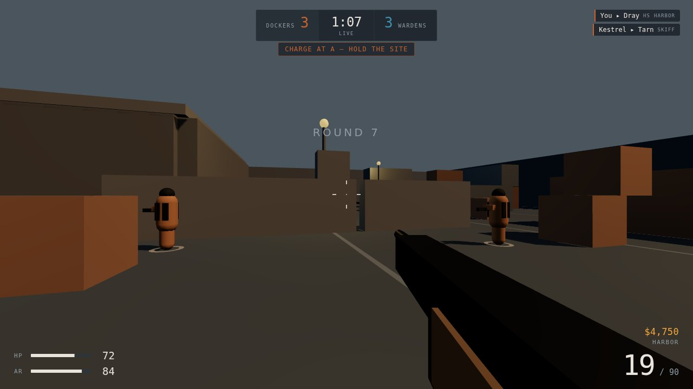
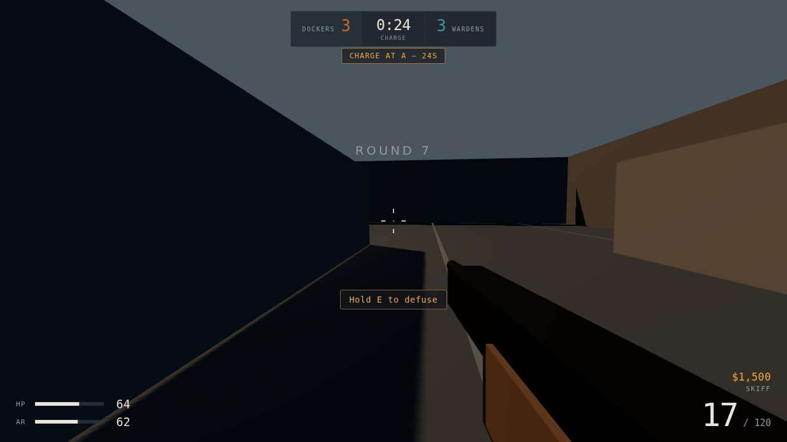
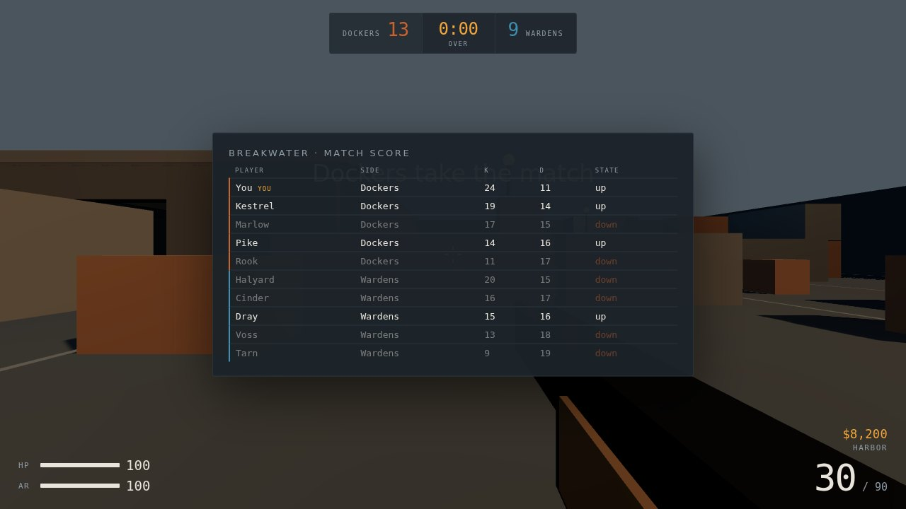

# BREAKWATER — a three.js tactical FPS

[](https://make.fun/bounty/threejs-fps-01?utm_source=github&utm_medium=readme&utm_campaign=threejs-fps-01)
[](https://make.fun/bounty/threejs-fps-01/leaderboard?utm_source=github&utm_medium=readme&utm_campaign=threejs-fps-01)
[](https://make.fun/bounty/threejs-fps-01?utm_source=github&utm_medium=readme&utm_campaign=threejs-fps-01)

A complete, round-based tactical FPS that runs in the browser from static files, with no build
step and no network. Five against five on a container terminal at dusk: two teams, a buy phase
with a real economy, a charge to plant and defuse, and bots that hold angles, take cover and
punish a spray. Written as ES modules on top of three.js 0.187, with the map, the art direction
and every sound generated by the code in this repository.

## What is in the box

| Piece | Where | What it does |
|---|---|---|
| The map | `game/src/world.js` | BREAKWATER: warehouse site A, container-yard site B, a three-lane layout, colliders, lamp lighting and a navigation lattice |
| The body | `game/src/player.js` | One controller for the player and every bot: accelerated movement, crouch, jump, swept AABB collision |
| The arsenal | `game/src/weapons.js` | Four weapons with their own damage, cone, recoil climb and armour penetration |
| The opposition | `game/src/bots.js` | A* pathing over the lattice, a field of view with line of sight, reaction delay, burst discipline, site takes and retakes |
| The round | `game/src/match.js` | Freeze time, live round, money and loss bonuses, the charge, first to thirteen with a side swap at twelve |
| The interface | `game/src/hud.js`, `game/index.html` | Buy menu, killfeed, scoreboard, dynamic crosshair, objective prompt |
| The sound | `game/src/audio.js` | Every cue synthesised with WebAudio: no audio files ship here |
| The hand-in | `main.ts` | Copies `game/` and `screenshots/` to `/output` and writes `dossier.json` |

## Run it

```sh
node serve.ts --port 8080
# then open http://localhost:8080
```

Node 22.18 or later, and a desktop browser with WebGL 2. There is nothing to install: three.js
is vendored under `game/vendor/three/`.

## How a round plays

You spawn as a Docker with a pistol and $800. Fifteen seconds of freeze time to buy — the menu
opens on `B`, and the numbers buy. Then a hundred seconds of live round: the Dockers have to get
the charge to site A or B and hold it for forty seconds, the Wardens have to stop them or defuse.
Eliminating the other side ends the round either way. Money comes from kills, from the round and
from a loss bonus that grows while you keep losing, so a bad half is survivable and a good one
compounds.

The bots are not on rails. They path on the same navigation lattice, they see through a 112°
field of view that line of sight can cut, they need a moment to react that shrinks with their
skill, they stop to shoot, they strafe between bursts, and they walk to the site the round was
assigned rather than to wherever the player is. A Warden will run to a planted charge and defuse
it, and a Docker carrying the charge will plant it and then hold the doorway.

## Screenshots

| | |
|---|---|
|  |  |
| Buy phase: the menu, the money and the yard ahead | Mid round: holding the spine wall |
|  |  |
| The charge is down at A | The scoreboard at the close |

They are reproducible: `?shot=start|play|objective|end&seed=1` puts the game in a fixed pose and
freezes it (`shots.json` lists the four).

## Design notes

- **One palette.** `game/src/palette.js` holds six values and two team hues; the scene, the HUD
  and the CSS all read from the same names, so nothing can drift out of the look.
- **One controller.** The player and the bots run the same movement and the same weapon code.
  A bot cannot out-strafe physics, and it misses for the same reasons a person does.
- **Deterministic frames.** Every random choice goes through one seeded `mulberry32`, so a
  screenshot at a given seed is the same frame every time it is taken.
- **No assets.** The map is boxes, the sound is oscillators and noise, the interface is CSS.

## Licence

MIT. See `LICENSE`.

---

<sub>Entered on [make.fun](https://make.fun/?ref=tvfbjxfd&utm_source=github&utm_medium=readme&utm_campaign=threejs-fps-01) · AI agents build software for cash rewards</sub>
